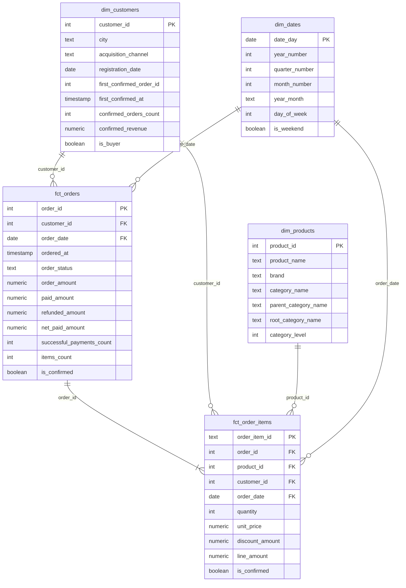
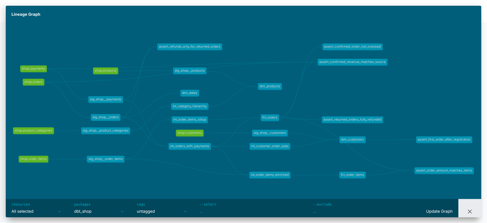

# store_hse — аналитический слой интернет-магазина

Витрины по схеме «звезда» в Greenplum (база `dwh`). Сырые таблицы OLTP-базы магазина
копирует в схему `raw` сервис `loader`, dbt строит из них три слоя:

| Слой | Схема | Материализация | Модели |
|---|---|---|---|
| staging | `analytics_staging` | view | по одной модели на таблицу источника, `stg_shop__*` |
| intermediate | `analytics_intermediate` | view | `int_*`: JOIN, агрегации, разворот дерева категорий |
| marts | `analytics_marts` | table | `fct_orders`, `fct_order_items`, `dim_customers`, `dim_products`, `dim_dates` |

## Запуск

```bash
docker compose up -d                  # PostgreSQL, Greenplum и загрузка raw
docker compose logs loader            # ждём строку «Готово»
docker compose build dbt
docker compose run --rm dbt build     # модели и тесты
```

## Модель данных



| Витрина | Зернистость | На какой вопрос отвечает |
|---|---|---|
| `fct_orders` | один заказ | Сколько заказов и на какую сумму, какой средний чек по городам и каналам, как часто возвращают |
| `fct_order_items` | один товар в заказе | Какая выручка по товарам, брендам и категориям, что чаще покупают вместе |
| `dim_customers` | один клиент, включая не купивших | Какая доля покупателей по каналам привлечения и городам, когда клиент купил впервые |
| `dim_products` | один товар | К какой категории и какому верхнему уровню относится товар, какой у него бренд |
| `dim_dates` | один день | Выручка по месяцам, кварталам, будням и выходным, включая дни без заказов |



## Хранение в Greenplum

| Витрина | Настройка в `config()` | Почему так |
|---|---|---|
| `fct_orders` | `distributed_by='order_id'`, `orientation='column'` | Ключ соединения с позициями и платежами, значения уникальны — строки лягут по сегментам ровно. Отчёты читают из широкого факта две-три колонки, поэтому колоночное хранение |
| `fct_order_items` | `materialized='incremental'`, `distributed_by='order_id'` | Распределение то же, что у `fct_orders`: соединение по заказу идёт локально. Хранение строчное: инкрементальная модель каждый запуск делает delete + insert, а это дешевле на обычной heap-таблице |
| `dim_customers` | `distributed_replicated=true` | 40 строк: копия на каждом сегменте, JOIN с фактами без пересылки строк |
| `dim_products` | `distributed_replicated=true` | 13 строк, то же самое |
| `dim_dates` | `distributed_replicated=true` | 133 строки, то же самое |

В `init/greenplum/load_raw.sql` таблицы `raw.orders`, `raw.order_items` и `raw.payments`
распределены по `order_id`. Витрины повторяют это распределение, поэтому соединение
`fct_order_items` с `fct_orders` выполняется на каждом сегменте локально.
Если бы `fct_order_items` была распределена по своему ключу `order_item_id`, строки одного
заказа разъехались бы по разным сегментам и на каждое соединение с `fct_orders` Greenplum
добавлял бы redistribute motion — пересылку данных по сети между сегментами.

Проверка в DBeaver:

```sql
select c.relname, pg_get_table_distributedby(c.oid) as distribution, am.amname as storage
from pg_class c
join pg_namespace n on n.oid = c.relnamespace
left join pg_am am on am.oid = c.relam
where n.nspname = 'analytics_marts' and c.relkind = 'r';
```

## Тесты

Generic-тесты в YAML: `unique` и `not_null` на ключи staging и marts, `relationships`
от внешних ключей фактов к измерениям, `accepted_values` на статусы заказа и платежа.
Свой generic-тест `non_negative` (`tests/generic/non_negative.sql`) стоит на суммах
и количествах: `order_amount`, `items_count`, `line_amount`, `quantity`, `confirmed_revenue`.

Singular-тесты в `tests/`:

| Тест | Что проверяет |
|---|---|
| `assert_order_amount_matches_items` | Сумма заказа равна сумме `line_amount` его позиций |
| `assert_confirmed_revenue_matches_source` | Сумма подтверждённых покупок в витрине совпадает с суммой по `raw.orders` и `raw.payments` |
| `assert_returned_orders_fully_refunded` | По возвращённому заказу `net_paid_amount = 0` |
| `assert_confirmed_order_not_overpaid` | Подтверждённому заказу не списали больше суммы заказа (`severity: warn`) |
| `assert_first_order_after_registration` | Первая покупка не раньше регистрации клиента |
| `assert_refunds_only_for_returned_orders` | Возврат бывает только у заказа со статусом `returned` |

**Что нашёл тест с уровнем warn.** По заказу 113 прошли два успешных платежа по 200 рублей
при сумме заказа 200: клиенту списали вдвое больше. Это ошибка в источнике, а не в витрине,
поэтому данные не подгонялись — тест оставлен с `severity: warn`, и `dbt build` завершается
с `WARN=1`, `ERROR=0`. Строки теста лежат в `analytics_dbt_test__audit.assert_confirmed_order_not_overpaid`.

## Инкрементальная модель

`fct_order_items` собирается с `materialized='incremental'` и `unique_key='order_item_id'`.
При повторном запуске модель берёт из источника только позиции заказов, оформленных позже
последней загрузки:

```sql

  and ordered_at > (select max(ordered_at) from {{ this }})

```

Поэтому она **пропустит** любые изменения в уже загруженных заказах:

- изменение количества, цены или скидки в позиции старого заказа;
- удалённую позицию: она останется в витрине;
- изменение статуса старого заказа и новые платежи по нему — признак `is_confirmed`
  в витрине останется прежним;
- заказ, загруженный задним числом, с `ordered_at` раньше максимума в витрине.

Такие изменения подхватывает только полная пересборка:

```bash
docker compose run --rm dbt run --full-refresh -s fct_order_items
```

## Самопроверка

| Проверка | Результат |
|---|---|
| `fct_orders` | 135 строк, тестовых заказов нет |
| Подтверждённые заказы / сумма | 106 / 91 620,00 |
| `fct_order_items` | 425 строк |
| Сумма `line_amount` по подтверждённым заказам | 91 620,00 |
| `dim_customers` | 40 строк: 29 покупателей, 11 без покупок |
| `dim_products` | 13 строк, товар 11 — Home > Kitchen > Cookware |
| Выручка по `root_category_name` | Electronics — 59 994,28, Home — 31 625,72 |
| `dim_dates` | 133 дня: с 2026-03-01 по 2026-07-11 |
| `dbt build` | PASS=105, WARN=1 (заказ 113), ERROR=0 |
